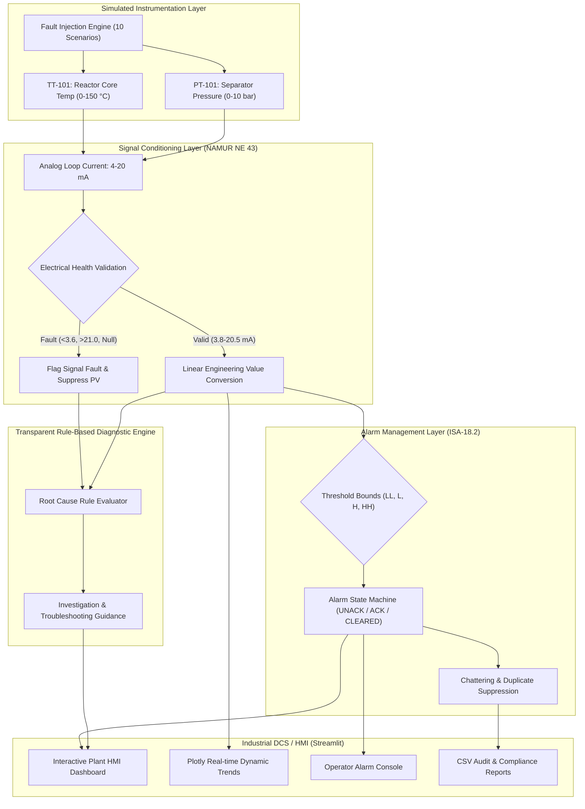
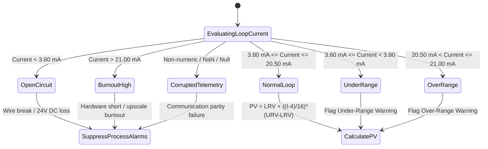
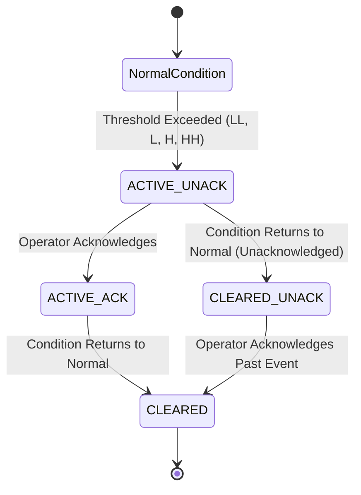

# System Architecture: Smart Process Instrumentation & Fault Diagnosis System

This document outlines the architectural blueprint, data flow, diagnostic decision model, and alarm state machine implemented in the **Smart Process Instrumentation & Fault Diagnosis System**.

---

## 1. High-Level System Architecture

The architecture separates physical process modeling, 4–20 mA current loop conversion, signal health evaluation, rule-based diagnostics, ISA-18.2 alarm management, and the user-facing Streamlit Industrial HMI.

---

## 2. 4–20 mA Signal Flow & NAMUR NE 43 Partitioning

Industrial analog current loops represent process parameters between $4.0\text{ mA}$ (0% of span) and $20.0\text{ mA}$ (100% of span). The system implements standard NAMUR NE 43 boundary thresholds to distinguish normal process excursions from electrical failures.

---

## 3. Alarm State Machine (ISA-18.2 Compliant)

Process alarms follow a standardized lifecycle that prevents alarm flooding, requires explicit operator acknowledgement, and tracks resolution:

### Key Principles Enforced:
1. **Critical Alarms Never Auto-Hide**: Active critical process and electrical faults remain visible in the operator queue until acknowledged.
2. **Duplicate Suppression**: Re-evaluating an active threshold during recurring UI renders updates the current value without spamming the audit log with redundant alarms.
3. **Decoupled Electrical vs. Process Alarms**: If a loop fails (e.g., open circuit at $0.0\text{ mA}$), a **SIGNAL FAULT** alarm is raised, while the process value is marked untrusted, preventing false low-temperature or low-pressure alarms.
